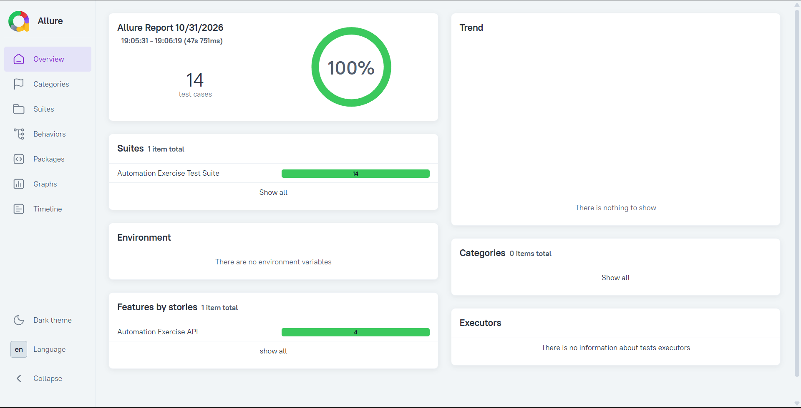

# Automation Exercise API Test Framework

This is my personal API automation project for the website [Automation Exercise](https://www.automationexercise.com/).

I built this framework to practice real-world API testing using **Java, RestAssured, TestNG, and Allure Report**.

---

## Tech Stack

- Java 25
- RestAssured
- TestNG
- Maven
- Allure Report
- POJO + Form Parameters
- Endpoint and payload class per API area (same separation idea as Page Object Model)

---

## Project Structure
```
src/test/java/
├── base/               → BaseTest (Request & Response Spec)
├── endPoints/          → API endpoints (User, Product, Brand, Login)
├── payload/            → POJO classes (User)
├── tests/              → Test classes
└── utilities/          → TestData + TestDataHelper

docs/                   → Report screenshots used in this README
```

---

## Features

- Clean and reusable endpoint methods
- Request and response specifications defined once in `BaseTest`
- No hardcoding (all data in `TestData`)
- POJO + Form Parameter support
- Positive and Negative test cases
- Allure Report integration
- TestNG Suite (`testng.xml`)
- Dynamic unique email generation

---

## Test Cases Covered (14 APIs)

| #  | Test Case                                      | Type      | Status |
|----|------------------------------------------------|-----------|--------|
| 1  | Get All Products List                          | Positive  | Done   |
| 2  | POST To All Products List                      | Negative  | Done   |
| 3  | Get All Brands List                            | Positive  | Done   |
| 4  | PUT To All Brands List                         | Negative  | Done   |
| 5  | POST To Search Product                         | Positive  | Done   |
| 6  | Search Product without parameter               | Negative  | Done   |
| 7  | Verify Login with valid details                | Positive  | Done   |
| 8  | Verify Login without email parameter           | Negative  | Done   |
| 9  | DELETE To Verify Login                         | Negative  | Done   |
| 10 | Verify Login with invalid details              | Negative  | Done   |
| 11 | Create/Register User Account                   | Positive  | Done   |
| 12 | Delete User Account                            | Positive  | Done   |
| 13 | Update User Account                            | Positive  | Done   |
| 14 | Get User Detail by Email                       | Positive  | Done   |

Current status: 14 of 14 tests passing, full suite runs in about 80 seconds.



---

## How to Run the Project

Prerequisites: JDK 25, Maven, and an internet connection. No API key is required, the suite calls the public API directly.

1. Clone the repository
2. Open it in IntelliJ IDEA
3. Make sure you have JDK 25 and Maven installed
4. Run the tests using:

```bash
mvn clean test
```

You can also run `testng.xml` directly from IntelliJ.

### Generate Allure Report

After running the tests, generate the report using:

```bash
allure serve allure-results
```

---

## Known limitations

- Runs against the live public API, so results depend on the internet and on the service being available.
- No authentication token flow is tested; the suite covers the public endpoints used by the website.
- Test data is created and deleted per run, so the suite needs a working internet connection to pass.

---

## Author

**Omar Monir**
Junior QA Automation Engineer

- GitHub: [Omar-Monir](https://github.com/Omar-Monir)
- LinkedIn: [omar-monir](https://linkedin.com/in/omar-monir-7191722b0)
- Email: omonir446@gmail.com
